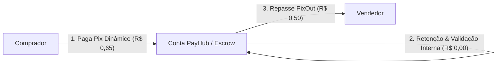

# Pesquisa Minuciosa de Tarifas Stark Bank para Operações Pix

Este documento apresenta uma análise aprofundada da estrutura tarifária oficial praticada pelo **Stark Bank** (Banking as a Service - BaaS) para empresas, com foco em operações Pix (cash-in, cash-out, geração de QR Code, consulta DICT e split).

---

## 1. Modelo de Negócio e Precificação

O Stark Bank opera sob o modelo **Pay-as-you-go** ("pague pelo que usar"), sem tarifas ocultas e focado em clientes corporativos (PJ) que realizam operações em escala via API direta conectada ao Sistema de Pagamentos Instantâneos (SPI) do Banco Central:

- **Abertura e manutenção de conta PJ:** R$ 0,00 (Sem anuidade ou mensalidade fixa da conta).
- **Taxa de adesão:** R$ 0,00.
- **Ambiente de Workspace:** R$ 1,00 / mês.
- **Webhooks e Notificações em tempo real:** R$ 0,00 (Sem custo por envio de webhook).

---

## 2. Tabela Oficial de Tarifas Pix

| Operação Pix | Custo de Processamento (Emissão) | Custo de Liquidação (Recebimento) | Custo Efetivo Total |
| :--- | :---: | :---: | :---: |
| **QR Code Dinâmico (`DynamicBrcode`)** | R$ 0,15 | R$ 0,50 | **R$ 0,65** |
| **Cobrança com Invoice (`Invoice Pix`)** | R$ 0,15 | R$ 0,50 | **R$ 0,65** |
| **QR Code Estático** | R$ 0,00 | R$ 0,50 | **R$ 0,50** |
| **Transferência Pix Out (Envio / Repasse)** | — | R$ 0,50 | **R$ 0,50** |
| **Consulta de Chave Pix (DICT)** | R$ 0,15 | — | **R$ 0,15** |
| **Split Automático de Pagamento** | — | — | **0,20% sobre o TPV** |

---

## 3. Detalhamento de Cada Operação

### 3.1. Geração de QR Code Dinâmico (`DynamicBrcode` / `Invoice`)
- **Processamento (R$ 0,15):** Cobrado no momento em que a sua aplicação faz a requisição via API para gerar a cobrança única com valor fixo e identificador exclusivo.
- **Liquidação (R$ 0,50):** Cobrado apenas quando o pagador efetivamente conclui o pagamento do Pix pelo aplicativo do banco dele.
- **Total do Cash-in Dinâmico:** R$ 0,65 por pagamento bem-sucedido.
- *Nota:* Se o QR Code dinâmico expirar sem pagamento, apenas a taxa de processamento (R$ 0,15) incide.

### 3.2. QR Code Estático
- **Processamento:** R$ 0,00 (Gratuito).
- **Liquidação:** R$ 0,50 por pagamento recebido.
- *Aplicação:* Recomendado para pontos fixos ou pagamentos sem conciliação individual de faturas com expiração rígida.

### 3.3. Transferência Pix (Pix Out / Repasse para o Vendedor)
- **Custo:** R$ 0,50 por transferência concluída.
- Ocorre via endpoint `starkbank.transfer.create` enviando o saldo líquido da conta operacional do PayHub diretamente para a chave Pix do vendedor após a liberação da garantia de custódia (escrow).

### 3.4. Consulta de Chave Pix no DICT (`DictKey`)
- **Custo:** R$ 0,15 por consulta.
- Utilizado para verificar se uma chave Pix cadastrada pelo usuário existe no Diretório de Identificadores de Contas Transacionais (DICT) do Banco Central e obter o nome do titular mascarado antes do envio.

### 3.5. Split de Pagamento
- **Custo:** 0,20% do TPV (Volume Total Transacionado).
- Incide caso utilize o módulo automatizado de divisão de recebíveis nativo do Stark Bank para partilhar o valor entre múltiplas contas do ecossistema.
- *Alternativa adotada no PayHub:* Como o PayHub utiliza **Ledger próprio com Escrow interno** (retém o valor total na conta PJ e emite o PixOut após confirmação), o custo de 0,20% do split é economizado, pagando-se apenas a tarifa fixa de R$ 0,50 da transferência.

---

## 4. Estudo de Custos Unitários no Fluxo do PayHub

Abaixo está a simulação exata do custo operacional por cada ciclo completo de compra e venda intermediada na plataforma:

### Composição de Custos de 1 Transação:
1. **Emissão e Liquidação do Pix Dinâmico:** R$ 0,15 + R$ 0,50 = **R$ 0,65**
2. **Transferência Pix para o Vendedor:** **R$ 0,50**
3. **Custo Total Stark Bank por Ciclo:** **R$ 1,15** (R$ 1,30 caso consulte DICT previamente).

### Margem da Plataforma com a Taxa Atual do PayHub:
- **Taxa cobrada pelo PayHub:** R$ 1,50 (ou percentual configurado)
- **Custo Stark Bank:** R$ 1,15
- **Lucro Líquido do PayHub:** **+ R$ 0,35 por transação** (ou mais se adotada taxa mista, ex: R$ 1,50 + 1,5%).

---

## 5. Comparativo: Stark Bank vs. Gateways Tradicionais

| Funcionalidade / Provedor | Stark Bank (BaaS) | Gateways Tradicionais (Asaas / Mercado Pago / Pagar.me) |
| :--- | :--- | :--- |
| **Pix Dinâmico (Recebimento)** | **R$ 0,65** (Fixo) | 0,99% a 1,99% (Variável com piso mínimo) |
| **Transferência Pix (Saída)** | **R$ 0,50** (Fixo) | R$ 1,50 a R$ 3,50 por saque |
| **Exemplo: Transação de R$ 500,00** | Custo total: **R$ 1,15** | Custo total: **~ R$ 6,50 a R$ 10,00** |
| **Exemplo: Transação de R$ 2.000,00** | Custo total: **R$ 1,15** | Custo total: **~ R$ 20,00 a R$ 40,00** |
| **Velocidade de Liquidação** | Instantâneo (SPI direto) | D+0 ou D+1 dependendo do plano |
| **Anonimato entre as partes** | Nativo (Transita na conta PJ) | Depende de subcontas ou split |

> 💡 **Conclusão:** Para valores médios e altos (como o teto de R$ 2.000,00 do PayHub), o modelo de tarifa fixa do Stark Bank gera uma **economia superior a 90%** em comparação a adquirentes percentuais.

---

## 6. Descontos por Escala e Volume Comprometido

O Stark Bank oferece negociação de pacotes com desconto progressivo à medida que a plataforma ganha escala:
- **Consumo Comprometido (Commitment):** Contratos com volume mínimo de transações mensais reduzem as tarifas de transferência e liquidação para faixas inferiores a R$ 0,30 por operação.
- **Grandes Volumes:** Negociação direta com a mesa de expansão institucional do Stark Bank para plataformas que movimentam alto TPV.

---

## 7. Outras Tarifas de Referência do Banco

Para fins de planejamento e expansão futura do PayHub:
- **Transferência via TED:** R$ 2,00 por operação.
- **Boleto Bancário:** R$ 0,15 processamento + R$ 2,00 liquidação.
- **Venda no Cartão de Crédito/Débito:** 3,5% por transação.
- **Consulta Boleto Holmes:** R$ 0,25 por consulta.
- **Emissão e Anuidade de Cartões Corporativos:** R$ 0,00.

---

*Pesquisa compilada com base na tabela tarifária oficial vigente do Stark Bank para contas corporativas.*
